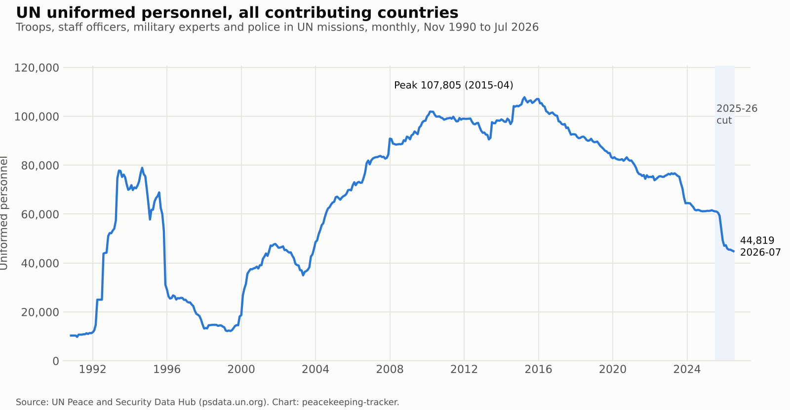
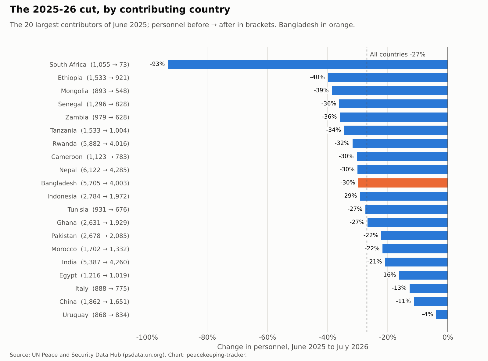
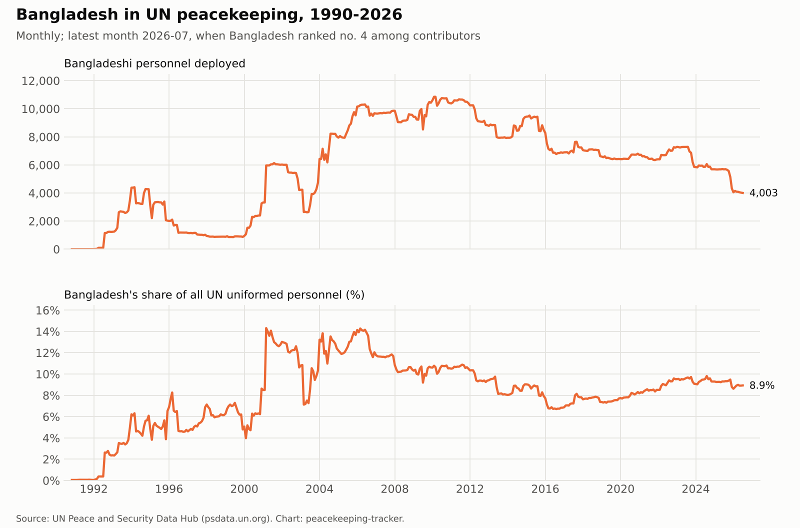
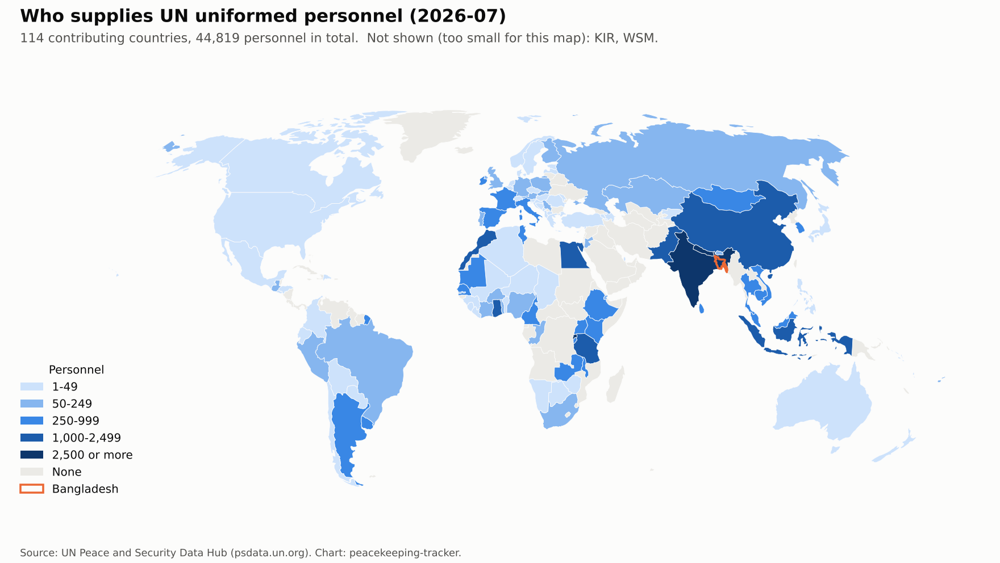
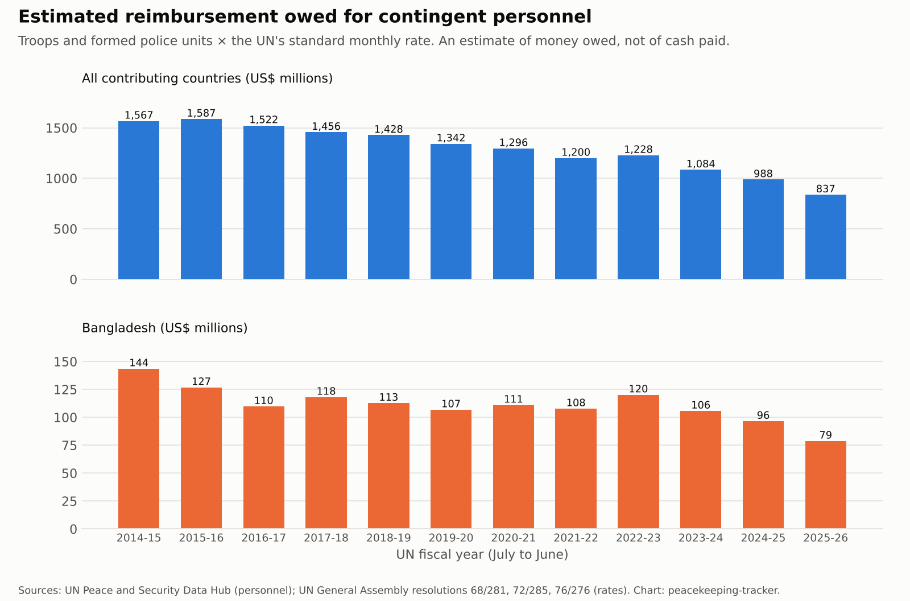

# peacekeeping-tracker

[](https://doi.org/10.5281/zenodo.23752306)

Published by [Mercenomics](https://mercenomics.org), an independent data archive on the business of force for hire.

A tracker of who supplies the soldiers and police in United Nations missions, month by month from November 1990 to July 2026: how many each country sends, how Bangladesh's place has changed, what happened in the 2025-26 cut, and roughly how much money the UN owes countries for their troops.

## What this is and why it matters

The UN has no army of its own. Every peacekeeper is lent by a member country, and for each soldier or police officer serving in a formed unit, the UN pays that country a fixed monthly amount (US$1,448 per person per month from July 2022, rising to US$1,474.68 in July 2026). For some countries this is a large and steady source of foreign income, which is why peacekeeping is sometimes described as a market in which governments supply security for a price.

The UN publishes the monthly numbers as two separate files, with different layouts, category names and gaps between them. This project joins them into one checked monthly series covering 429 months, 162 contributing countries and every UN mission in the files. It can be used to follow any country's contribution over time, to compare contributors, to measure how a mission's closure or a budget cut falls on different countries, and to estimate what each country is owed.

**Headline numbers** (all from the tables in [`tables/`](tables/)):

- UN uniformed personnel peaked at **107,805 in April 2015**. By **July 2026** there were **44,819**.
- Between **June 2025 and July 2026** the total fell by **16,480 people (27%)**. Most of the drop came in October to December 2025.
- **Bangladesh** was the largest contributor in 124 months since 1990, more than any other country. In the cut its contingent fell from **5,705 to 4,003 (30%)**, slightly more than the average, and it slipped to **fourth place**, behind Nepal, India and Rwanda.
- At the UN's standard rate, the reimbursement owed for Bangladesh's troops and formed police units fell from an estimated **US$96.5 million in 2024-25 to US$78.8 million in 2025-26**.











## Why the full dataset is not in this repository

The UN's terms of use for its websites allow its data to be downloaded for personal, non-commercial use, but not redistributed. So this repository does **not** contain the UN's files or the full combined dataset. Instead it contains:

- the code that downloads the UN's files directly from the UN and rebuilds the full dataset on your own computer, exactly as used here;
- short summary tables and charts;
- a check that tells you whether the dataset you rebuilt is identical to the one behind this release.

## The tables

| File | What it holds |
|---|---|
| [`tables/monthly_totals.csv`](tables/monthly_totals.csv) | All countries combined, by month and personnel category, Nov 1990 to Jul 2026 |
| [`tables/bangladesh_by_year.csv`](tables/bangladesh_by_year.csv) | Bangladesh by year: average personnel, average share of the total, best and worst monthly rank |
| [`tables/top_contributors_latest.csv`](tables/top_contributors_latest.csv) | The 20 largest contributors in July 2026 |
| [`tables/cut_2025.csv`](tables/cut_2025.csv) | June 2025 vs July 2026 for the 20 largest contributors of June 2025, plus the total |
| [`tables/reimbursement_estimate.csv`](tables/reimbursement_estimate.csv) | Estimated reimbursement owed by UN fiscal year (July to June), 2014-15 onward, all countries and Bangladesh |
| [`data/reference/reimbursement_rates.csv`](data/reference/reimbursement_rates.csv) | The UN's standard reimbursement rates and the General Assembly resolutions that set them |

## The full dataset (rebuilt on your computer)

`data/build/contributions_monthly.csv`, one row per month, contributing country, mission and personnel category (306,172 rows).

| Column | Meaning |
|---|---|
| `month` | Calendar month (`YYYY-MM`) |
| `iso3` | Contributing country code (ISO 3166-1 alpha-3), as given by the UN |
| `country` | Contributing country, using the UN's most recent name for that code |
| `country_as_published` | The name exactly as written in the UN file for that month |
| `mission` | Mission acronym, as given by the UN |
| `category` | Harmonised personnel category (below) |
| `category_as_published` | The column or category name used in the UN file |
| `male`, `female` | Numbers by sex (from January 2010 only) |
| `total` | Number of personnel |
| `source` | Which UN file the row comes from |

**Personnel categories.** The UN changed its categories over time, so the dataset keeps the original name and adds one consistent name:

| `category` | Covers |
|---|---|
| `troops` | Soldiers in formed military units |
| `staff_officers` | Military staff officers. Reported separately only from May 2017; before that they are counted inside `troops` |
| `experts_on_mission` | Military experts and observers ("Observers" before 2010) |
| `police_individual` | Individual police officers |
| `police_formed_units` | Formed police units |
| `police_unsplit` | All police, before November 2009, when the UN did not split individual officers from formed units |

Numbers are kept **exactly as published**. Nothing has been corrected, estimated or filled in.

## Things to know before using the numbers

- **All UN missions in the files are included**, mostly peacekeeping operations but also a few political missions and support offices that have uniformed personnel (for example UNAMI in Iraq and UNSOS in Somalia). The totals are therefore "UN uniformed personnel", which is how the UN itself reports them.
- **The series ends in July 2026**, the latest month available when it was built. The UN keeps adding months; the code is fixed to July 2026 so that every rebuild gives the same result. Change `END_MONTH` in `code/02_build_panel.py` to extend it.
- **Some months are not dated on the last day** (for example 30 October 2024). Months are matched by calendar month.
- **Twelve rows give no number** (a country and mission are listed with both male and female empty). They count as missing, not zero.
- **The reimbursement estimate is money owed at the standard rate, not cash paid.** It is troops plus formed police units, multiplied by the standard monthly rate. It leaves out payments for equipment, bonuses and penalties, and the UN often pays countries late. Before May 2017 a small number of staff officers, whom the UN does not reimburse this way, are inside `troops`, so those years are slightly overstated. Estimates start in July 2014, when the single standard rate began.

## How the numbers were checked

Run by [`code/03_check.py`](code/03_check.py); results in [`data/check_report.md`](data/check_report.md).

1. Every month from November 1990 to July 2026 is present in the UN files.
2. There are no duplicate rows.
3. Two overlaps in the UN's pre-2010 file were confirmed and removed. In November and December 2009 the old police column is the exact sum of the new split, and the new "experts" column repeats the old "observers" column.
4. Male plus female equals the total in every row where both are given.
5. Every police number matches the UN's separate police file, row by row (51,972 rows, no differences).
6. The join between the two UN files has no break: 98,194 in December 2009 and 99,943 in January 2010.
7. Every month-to-month change of more than 5% is listed for review. The large ones match known events, such as the start of large missions in the former Yugoslavia, Cambodia and Somalia in 1992-93, and the end of the Yugoslavia mission (UNPROFOR) in December 1995.
8. The rebuilt dataset matches this release's monthly totals exactly, so anyone rebuilding it can confirm they have the same data.
9. **Cross-check against the UN peacekeeping website.** The monthly ranking reports on peacekeeping.un.org were compared country by country for June 2025, October 2025, January 2026 and February 2026, covering the period before, during and after the cut. Every country's total and every month's grand total match exactly (for example 61,299 in June 2025 and 47,298 in February 2026). Run by [`code/06_crosscheck_un_website.py`](code/06_crosscheck_un_website.py); results in [`data/crosscheck_un_website.md`](data/crosscheck_un_website.md).

## Reproduce it

Needs Python 3.10 or later.

```
pip install -r requirements.txt
python code/01_download.py
python code/02_build_panel.py
python code/04_tables.py
python code/03_check.py
python code/05_figures.py
```

Step 3 is run after step 4 because its last check compares your rebuilt data with the published monthly totals.

Optional: `python code/06_crosscheck_un_website.py` runs the website cross-check. The website refuses automated downloads, so its PDFs must first be saved by hand (instructions at the top of the script). It also needs Poppler (`pdftotext`).

## Folders

| Folder | Contents |
|---|---|
| `code/` | Numbered scripts |
| `data/raw/` | Created when you run step 1: the UN files and map borders (not in the repository) |
| `data/build/` | Created when you run step 2: the full monthly dataset (not in the repository) |
| `data/reference/` | The UN's standard reimbursement rates |
| `tables/` | Summary tables |
| `figures/` | Charts and the map |

## Related research

This data will be used in a working paper, now in preparation, on which contributing countries bore the 2025-26 reduction in UN peacekeeping.

## Sources and license

Sources and download details are in [`data/README.md`](data/README.md). Code: MIT (see [`LICENSE`](LICENSE)). The reimbursement-rate table: CC BY 4.0. The summary tables and charts are made from the UN's figures; please credit both this project and the UN, and note that the UN's own files are subject to the UN's terms of use. Map borders: Natural Earth (public domain).

The designations used and the presentation of material on the map do not imply the expression of any opinion concerning the legal status of any country or territory or the delimitation of its frontiers.

## Cite

Azom, Kazi Affnann (2026). *peacekeeping-tracker: monthly UN uniformed personnel contributions by country, 1990-2026* (Version v1.0.0) [Software]. Mercenomics. https://doi.org/10.5281/zenodo.23752307

- This version (v1.0.0): [10.5281/zenodo.23752307](https://doi.org/10.5281/zenodo.23752307)
- All versions (always points to the latest): [10.5281/zenodo.23752306](https://doi.org/10.5281/zenodo.23752306)

Please also cite the UN as the source of the personnel figures. See also [`CITATION.cff`](CITATION.cff).
